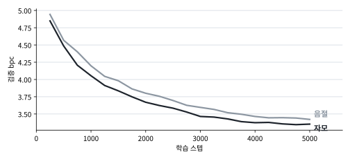

# jamo-lepigado

받침을 보는 토크나이저. 한국어 GPT를 같은 데이터, 같은 크기로 두 번 학습시키고 **글을 자르는 방식 하나만** 다르게 했다.

- **음절 BPE**: `낮`을 더 쪼갤 수 없는 글자 하나로 본다.
- **자모 BPE**: `낮`을 `ㄴ ㅏ ㅈ`으로 풀어서 본다.

**[웹 데모](https://fishilyfishyfish.github.io/jamo-lepigado/)**: 두 모델을 브라우저에서 직접 돌린다. 토크나이저가 문장을 어떻게 자르는지 보고, 치는 도중에 단어를 맞히게 하고(‘서우’까지 치면 ‘서울’), 가짜 단어로 조사 고르기를 시키고, 이어 쓰기도 해볼 수 있다.

[](https://colab.research.google.com/github/fishilyfishyfish/jamo-lepigado/blob/main/colab.ipynb)

## 왜

`낮`과 `낯`은 받침 하나만 다르다. 그런데 음절 단위 토크나이저를 쓰는 언어 모델에게 둘은 서로 아무 관계 없는 번호 두 개다. 유니코드에서도 바로 옆 번호(U+B0AE, U+B0AF)라서 "둘 다 ㄴ+ㅏ인데 받침만 ㅈ/ㅊ"이라는 구조가 입력 어디에도 안 드러난다. 모델은 그걸 데이터에서 따로 외워야 한다.

한국어 조사는 바로 이 받침에 따라 바뀐다(사과**를** / 책**을**, 학교**로** / 집**으로** / 서울**로**). 그러면 받침을 직접 볼 수 있는 모델이 처음 보는 단어에서도 조사를 더 잘 고를까? 이 저장소는 그걸 확인한다.

## 어떻게

**자모 분해.** 현대 한글 음절 11,172자는 공식 하나로 배치돼 있어서 산술만으로 분해/조합된다.

```
음절 = 0xAC00 + (초성 × 21 + 중성) × 28 + 종성      초성 19, 중성 21, 종성 28(0 = 받침 없음)
```

분해 결과는 조합형 자모(U+1100~)로 쓴다. 이 영역은 초성 ㄴ과 종성 ㄴ이 다른 글자라서 자모열만 보고도 음절이 정확히 복원된다.

**BPE.** 라이브러리 없이 직접 구현했다. 단어 앞에 `▁`를 붙이고, 가장 자주 붙어 나오는 쌍부터 합친다. 바뀐 단어만 다시 세는 증분 방식이고, 매번 처음부터 다시 세는 느린 구현과 결과가 똑같은지 테스트로 확인한다.

**모델.** GPT(6층, 384차원, 어휘 8000, 약 1400만 파라미터). 두 모델은 토크나이저만 빼고 데이터, 크기, 학습 스텝, 시드가 모두 같다.

**평가.**
- **bpc(글자당 비트)**: 토크나이저마다 같은 글을 표현하는 토큰 수가 달라서, 토큰당 손실은 서로 비교할 수 없다. 글자 기준으로 환산해서 비교한다.
- **받침-조사 테스트**: `나는 ○○을/를 좋아한다`의 두 문장 중 어느 쪽에 확률을 더 주는지 본다. 을/를, 이/가, 은/는, 으로/로 네 쌍을 쓴다. 실제 명사 46개와, 코퍼스에 한 번도 안 나온 가짜 명사 120개로 따로 채점한다. 가짜 명사 점수가 핵심이다. 외운 단어가 아니라 받침 규칙을 쓰는지 보여주기 때문이다.

## 결과

한국어 위키백과 5천만 자, 모델마다 5000스텝(4100만 토큰). Colab T4에서 하나에 6분 남짓 걸렸다.



| | 자모 | 음절 |
|---|---|---|
| bpc (낮을수록 좋음) | **3.354** | 3.436 |
| 글자당 토큰 수 | 0.492 | 0.501 |
| 조사 정답률, 실제 명사 46개 (4쌍 평균) | 99.5% | 98.4% |
| 조사 정답률, 가짜 명사 120개 (4쌍 평균) | 96.3% | 95.6% |

가짜 명사 쌍별:

| | 을/를 | 이/가 | 은/는 | 으로/로 |
|---|---|---|---|---|
| 자모 | 98.3% | 92.5% | 98.3% | 95.8% |
| 음절 | 95.8% | 95.0% | 97.5% | 94.2% |

**읽는 법**

- **bpc는 자모가 2.4% 낮다.** 다만 두 모델은 같은 토큰 수만큼 학습했고, 자모 쪽이 글자당 토큰이 1.9% 적어서 그만큼 글을 더 봤다. 음절 모델 곡선을 보면 학습을 25% 더 해도(4000→5000스텝) bpc가 1.2% 줄었다. 그러니 글을 1.9% 더 본 것만으로는 이 차이를 대부분 설명하기 어렵다. 학습률 감소 효과가 섞여 있어서 거친 추정이다.
- **조사 테스트는 비겼다.** 가짜 명사 480문항(120개 × 4쌍) 중 자모 462개, 음절 459개를 맞혀서 3문항 차이다. "자모 모델이 처음 보는 단어의 받침을 더 잘 쓴다"는 가설은 이 설정에서는 확인되지 않았다. 가짜 명사를 코퍼스에 자주 나오는 음절 300개로 만들었기 때문으로 보인다. 그 음절들은 음절 모델도 뒤에 조사가 붙는 걸 수없이 봤으니, 끝 음절마다 받침 여부를 외울 수 있었다.
- 모델을 하나씩만 학습시켜서 시드에 따른 흔들림은 아직 모른다.
- 웹 데모용 int8 모델은 bpc 3.3458 → 3.3459(자모, 검증 20만 토큰)로 손실이 거의 없다.

**생성 샘플** (온도 0.8). 위키 문장 틀은 배웠지만 사실은 못 외웠다. 세종은 태종의 셋째 아들이다.

| 시작 | 자모 | 음절 |
|---|---|---|
| 세종대왕은 | 세종대왕은 세종대왕의 아들이자 서광대왕의 아들이다. | 세종대왕은 진나라에 들어갔고, 고려로부터의 조국을 장악했다. |
| 대한민국의 수도는 | 대한민국의 수도는 대한민국의 정치인이다. | 대한민국의 수도는 대한민국의 가수 김은정. |
| 고양이는 | 고양이는 경기도 부산시 남구 서구 서호리로 이전하였다. | 고양이는 다음과 같은 뜻은 다음과 같다. |

**다음 할 일**

- 드물게 나오는 음절로 끝나는 가짜 명사로 조사 테스트. 음절 모델이 외울 수 없는 경우라 자모의 장점이 드러나야 할 자리다.
- 형태소 분리를 더해서 2×2(음절/자모 × 형태소 분리 유무) 비교
- 시드를 바꿔 여러 번 학습시켜서 오차 범위 구하기
- 데이터 정리에서 한자를 지우면서 남은 빈 괄호 `()` 없애기. 지금은 생성 문장에 그대로 나온다.
- 치는 도중 단어 맞히기를 수치로 재기. 검증 문장을 자판 입력 순서대로 쪼개서, 각 중간 상태에서 정답 단어가 추천 3개 안에 드는 비율을 본다. 지금 데모는 두 모델 모두 같은 자모 앞부분 규칙으로 후보를 거르기 때문에, 차이는 모델이 매기는 확률에서만 난다.

## 직접 돌리기

Colab(T4 GPU)에서 `colab.ipynb`를 위에서부터 실행하면 된다. 로컬에서는:

```bash
pip install -r requirements.txt
python main.py corpus                  # 한국어 위키백과 5천만 자 -> corpus.txt
python main.py all --mode jamo         # 토크나이저 -> 인코딩 -> 학습 -> 평가 -> 웹용 내보내기
python main.py all --mode syl
python main.py compare                 # 두 결과를 표로
python main.py gen --mode jamo --prompt "세종대왕은"
```

단계를 따로 돌리려면 `all` 대신 `tok`, `prep`, `train`, `eval`, `export`. 모델 크기나 스텝은 `--layers`, `--embd`, `--steps` 같은 옵션으로 바꾼다(`python main.py -h`).

## 구조

```
jamo/hangul.py     자모 분해/조합 (유니코드 산술)
jamo/bpe.py        BPE 학습/인코딩/디코딩
jamo/model.py      GPT
jamo/evaluate.py   bpc, 받침-조사 테스트, 생성
jamo/export.py     웹용 내보내기 (행렬은 행 단위 int8)
main.py            명령줄
docs/              웹 데모 (GitHub Pages). 토크나이저와 GPT 추론을 JS로 다시 구현
tests/             파이썬 테스트, JS 구현이 파이썬과 같은 결과를 내는지 비교
colab.ipynb        학습 노트북
```

테스트는 `python -m pytest`. JS 비교 테스트는 Node가 있어야 돈다.

## 참고

- Moon & Okazaki, [Jamo Pair Encoding](https://aclanthology.org/2020.lrec-1.429) (LREC 2020): 자모 단위 서브워드 토큰화
- Lee et al., [Jamo-Level Subword Tokenization in Low-Resource Korean Machine Translation](https://aclanthology.org/2025.loresmt-1.8) (LoResMT 2025): 저자원 번역에서 자모 BPE가 음절·바이트 단위보다 나음
- Park et al., [An Empirical Study of Tokenization Strategies for Various Korean NLP Tasks](https://github.com/kakaobrain/kortok) (AACL 2020): BPE 없이 자모로만 자르면 오히려 성능이 떨어진다는 결과도 있음
